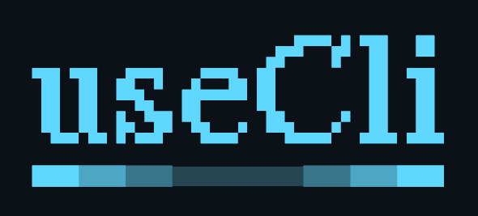

<a name="readme-top"></a>

<div align="center">
  <a href="https://github.com/thememium/usecli">
    
  </a>

  <p align="center">
    <a href="#table-of-contents"><strong>Explore the Documentation »</strong></a>
    <br />
    <a href="https://github.com/thememium/usecli/issues">Report Bug</a>
    ·
    <a href="https://github.com/thememium/usecli/issues">Request Feature</a>
  </p>
</div>

<!-- TABLE OF CONTENTS -->

<a name="table-of-contents"></a>

<details>
  <summary>Table of Contents</summary>
  <ol>
    <li><a href="#about">About</a></li>
    <li><a href="#quick-start">Quick Start</a></li>
    <li><a href="#usage">Usage</a></li>
    <li><a href="#entry-points--packaging">Entry Points &amp; Packaging</a></li>
    <li><a href="#development">Development</a></li>
    <li><a href="#contributing">Contributing</a></li>
    <li><a href="#license">License</a></li>
  </ol>
</details>

<!-- ABOUT -->

## About

useCli A powerful Python CLI framework for building beautiful, developer-friendly command-line tools. It gives you:

- **Prefix matching** — Type `he` instead of `help`
- **Interactive mode** — Searchable command picker
- **Auto-generated help** — Clean, styled output
- **Command scaffolding** — `make:command` generates boilerplate
- **UI components** — Prompts, menus, styled console output

<p align="right">(<a href="#readme-top">back to top</a>)</p>

<!-- QUICK START -->

## Quick Start

### Install usecli with uv (recommended)

```sh
uv add usecli
```

### Install with pip (alternative)

```sh
pip install usecli
```

### Initialize

```sh
usecli init
```

### ASCII-art titles (optional)

```sh
uv add "usecli[figlet]"
# or: pip install "usecli[figlet]"
```

The extra installs [pyfiglet](https://github.com/pwaller/pyfiglet). With it,
`usecli init` offers a figlet font picker and banners are rendered in the
chosen font. Without it, the picker is skipped and banners print as colored
text: title and version on one line, description below.

### Create a command

```sh
usecli make:command hello
```

Your new command is ready in the commands directory:

```python
class HelloCommand(BaseCommand):
    def signature(self) -> str:
        return "hello"

    def description(self) -> str:
        return "Say hello"

    def handle(self, name: str = Argument(..., help="Your name")) -> None:
        console.print(f"Hello, {name}!")
```

Run it:

```sh
usecli hello world
```

<p align="right">(<a href="#readme-top">back to top</a>)</p>

<!-- USAGE -->

## Usage

### Prefix Matching

Type partial command names:

```sh
usecli he          # help
usecli ma:co       # make:command
```

### Interactive Mode

```sh
usecli --interactive    # Searchable picker for all commands
usecli -i hello         # Run 'hello' command interactively
```

The picker opens in-place with vim-style keys: `j`/`k` or the arrow keys move,
`/` starts search, and enter runs the highlighted command. `esc` leaves search
mode but keeps the filter active (normal-mode navigation still works); `ctrl-u`
clears the filter. Command names, descriptions, the title and the status bar use
your theme colors; the highlighted row switches to the theme's highlight style.

### Command Groups

Colon-separated commands group automatically in help:

```python
def signature(self) -> str:
    return "db:migrate"
```

Displays as:

```
db:
  migrate    Run migrations
  backup     Backup database
```

Space-separated signatures create nested subcommands:

```python
def signature(self) -> str:
    return "spec show"  # usecli spec show
```

### JSON Output

Every command inherits `--json`; commands do not declare the option themselves. The flag works before or after a command name:

```sh
usecli --json about
usecli about --json
```

A successful invocation writes exactly one JSON document to stdout:

```json
{"ok":true,"data":null}
```

A command can return any JSON-serializable value to populate `data`:

```python
class StatusCommand(BaseCommand):
    def signature(self) -> str:
        return "status"

    def description(self) -> str:
        return "Show service status"

    def handle(self):
        return {"status": "ready", "workers": 3}
```

Failures preserve a non-zero exit status and use a stable error envelope:

```json
{"ok":false,"error":{"type":"UsageError","message":"No such command","code":2}}
```

In JSON mode, stdout is reserved for that document. Human-facing output, including `console.print()` and ordinary `print()`, is routed to stderr. Prompts and confirmations resolve their declared defaults without reading stdin. A prompt without a default, menus, and `--interactive` fail immediately with a structured `NonInteractiveError` instead of blocking.

The existing fields `ok`, `data`, `error`, `error.type`, `error.message`, and `error.code` keep their names and types across compatible releases. New fields may be added.

### UI Components

```python
from usecli import Confirm, Menu, Prompt, console

console.print("[green]Done![/green]")
name = Prompt.ask("Enter name")
port = Prompt.ask("Port", type="int", default=8000)
ratio = Prompt.ask("Ratio", type="float", default=0.5)
token = Prompt.ask("API token", password=True)
masked = Prompt.ask("PIN", mask="*")
mode = Prompt.ask("Mode [a/b/c]", choices=["a", "b", "c"], single_key=True)
ok = Confirm.ask("Continue?", single_key=True)
choice = Menu.select(["A", "B", "C"])
```

`Prompt.ask(type=...)` parses `"string"` (default), `"int"`, or `"float"`.
`password=True` hides input entirely; `mask="*"` echoes one mask character per
keystroke (and wins if both are supplied) and falls back to hidden input
without a terminal. Single-key
`Prompt.ask(..., single_key=True)` answers single-character choices on the
first keypress; `Confirm.ask(..., single_key=True)` does the same for `y`/`n`.
Without the flag both keep Rich's line-based prompt, and non-terminal
stdin/stdout always falls back to line input. In JSON mode prompts return their
declared default or raise `NonInteractiveError`.

Rich renderables are re-exported, so commands never import `rich` directly:

```python
from usecli import Markdown, Panel, Syntax, Table, Tree

console.print(Panel(Markdown("# Report")))
console.print(Syntax(source, "python"))
```

`from usecli.rich import ...` exposes the same set as an explicit namespace. All
Rich console, text, layout, progress, and prompt components are covered
(`Table`, `Tree`, `Panel`, `Rule`, `Layout`, `Live`, `Progress`, `Pretty`,
`JSON`, `Traceback`, and the rest); imports stay lazy, so `import usecli` does
not load Rich.

### Progress Indicators

Use `Spinner` when the amount of work is unknown and `ProgressBar` when a total is known:

```python
from usecli import ProgressBar, Spinner

with Spinner("Loading records") as spinner:
    load_records()
    spinner.update("Indexing records")

with ProgressBar(total=len(items), description="Processing") as progress:
    for item in items:
        process(item)
        progress.advance()
```

Progress always renders to stderr, uses the active usecli theme, and is suppressed automatically in JSON mode, with `quiet=True`, or when stderr is not attached to a terminal. Calling commands do not need to detect these conditions.

### Available Commands

```
about        Show app info
help         Show help
init         Initialize usecli (usecli only)
inspire      Random quote
upgrade      Upgrade the application to the latest version
make:command Create new command (usecli only)
make:theme   Create new theme (usecli only)
make:skill   Create a bundled skill (usecli only)
make:bundle  Build a standalone executable with PyInstaller (usecli only)
skill:install Install bundled skills (usecli installs the usecli skill)
```

### Coding Agent Skills

Every usecli CLI can ship its own Agent Skills. A skill is a directory with a
`SKILL.md` under `paths.skills` (default `skills` beside
`usecli.config.toml`):

```
src/mycli/
  skills/
    deploy-checks/
      SKILL.md
```

Scaffold one from the project with the `usecli` framework binary:

```bash
usecli make:skill deploy-checks --description "Check deployments"
```

`make:skill` is a framework scaffolding command, not a project-CLI command.
The generated skill belongs to the project CLI and is installed by the project
CLI:

```bash
mycli skill:install --skill deploy-checks
```

A project CLI exposes `skill:install` only when it has at least one bundled
skill. It installs project skills only and does not install the generated
`usecli` skill:

```bash
mycli skill:install                          # project: .claude/, .agents/, .cursor/
mycli skill:install --global                 # user: ~/.claude/, ~/.agents/, ~/.cursor/
mycli skill:install --list                   # show bundled skills and targets
mycli skill:install --skill deploy-checks    # one project skill
mycli skill:install --agent claude,codex     # one or more agents
```

The framework binary always exposes `skill:install` for its own generated
skill. The description is specific to the `usecli` skill:

```bash
usecli skill:install                         # install the usecli skill
usecli skill:install --global                # user-level usecli skill
usecli skill:install --list                  # show the usecli skill and targets
```

The generated `usecli` skill is derived from the running app, so the installed
reference always lists the live commands, options, themes, JSON contract,
prompts, progress, configuration, and packaging.

Supported targets are `claude`, `opencode`, `codex`, `pi`, `prime-agent`,
`omp`, `cursor`, and `agents`; `--agent all` selects every target. Global
installs honor `CLAUDE_CONFIG_DIR`, `OPENCODE_CONFIG_DIR`, `XDG_CONFIG_HOME`,
`CODEX_HOME`, `PI_CODING_AGENT_DIR`, `PRIME_AGENT_CODING_AGENT_DIR`, and
`OMP_AGENT_DIR`.

Installation is idempotent. Managed files carry a `<!-- usecli-skill: ... -->`
hash marker: an exact re-run changes nothing, a new release updates its own
files, and locally edited files are preserved. Use `--force` only when you
intend to replace those edits.

The same machinery is available from Python:

```python
from usecli.skills import Skill, install_skills

install_skills(
    [
        Skill(
            name="deploy-checks",
            description="Check deployments",
            content="---\nname: deploy-checks\ndescription: Check deployments\n---\n",
        )
    ],
    agents=["claude"],
    scope="project",
)
```

### Upgrades

Every CLI built on usecli ships `upgrade`, which detects how the running
package was installed and delegates to the same package manager — `uv tool`,
`pipx`, or `pip` — instead of creating a second installation:

```bash
mycli upgrade --check   # show installed/latest versions and the source
mycli upgrade           # confirm and install the latest release
mycli upgrade --force   # skip the prompt and the up-to-date check
```

The source comes from packaging metadata: PyPI for index installs, and the
Git remote for PEP 610 `direct_url.json` installs. Override it in
`usecli.config.toml` when metadata is not enough (private mirrors, missing
`direct_url.json`, a package name that differs from the command name):

```toml
[usecli.upgrade]
enabled = true
source = "git"                                  # "auto" (default) | "pypi" | "git"
package = "mycli"                               # optional
url = "https://github.com/owner/mycli.git"      # required for "git" unless detected
ref = "main"                                    # branch, tag, or commit
```

Frozen bundles, editable installs, and commit-pinned installs are reported
as non-upgradeable with an explanation and manual next step.

<p align="right">(<a href="#readme-top">back to top</a>)</p>

<!-- ENTRY POINTS & PACKAGING -->

## Entry Points &amp; Packaging

A usecli CLI can be exposed in several ways, depending on how you distribute and
run it. There are three common setups — none requires anything but the base
`usecli` install, and the optional bundler adds PyInstaller packaging on top.

### 1. Default — console script (no entry point)

The simplest setup. Declare a console script in your project's `pyproject.toml`:

```toml
[project.scripts]
mycli = "usecli:main"
```

usecli resolves your project's config automatically from the current directory
(config discovery), so no `main.py` is required. Install and run it:

```sh
uv add usecli
uv run mycli --help
```

This is the **default** — no entry point file of your own is needed.

### 2. Custom entry point — `main.py`

If you want your own entry point, use the public runtime API. It works in both
development and frozen bundles, and accepts an optional config path (the config
file is always named `usecli.config.toml`):

```python
# main.py
from usecli import run


def main():
    run()  # auto-detect project config
    # run("path/to/usecli.config.toml")          # or point at a specific config


if __name__ == "__main__":
    main()
```

Run it in development (no PyInstaller required):

```sh
uv run python main.py --help
```

To expose the same entry point as a console script, point `[project.scripts]`
at the `main` function in your `myapp` package (the usual `src/myapp` layout):

```toml
[project.scripts]
myapp = "myapp:main"
```

Because `run()` injects the located config explicitly, a custom `main.py` works
regardless of whether your CLI also has a `[project.scripts]` entry.

### 3. Bundler — standalone executable (optional, requires PyInstaller)

The bundler is an **optional** feature gated on PyInstaller being installed.
Install it with:

```sh
uv add "usecli[pyinstaller]"
```

Once installed, a `make:bundle` command appears (usecli only) that builds your
project into a standalone executable. It asks which mode to use via an
interactive menu, and confirms before building (defaults to no unless `-y`):

```sh
uv run usecli make:bundle                  # menu: one file vs one folder + confirm
uv run usecli make:bundle --mode onefile   # single-file executable
uv run usecli make:bundle --mode onedir    # one-folder bundle
uv run usecli make:bundle -y               # skip the confirmation
uv run usecli make:bundle --mode onedir -y # fully programmatic
uv run usecli make:bundle --mode onedir --zip -y  # one-folder bundle + zip
```

When building a **one-folder** bundle, `make:bundle` asks whether to also zip
the folder into `dist/<name>.zip` (PyInstaller's recommended distribution
format for one-folder mode). Pass `--zip` / `--no-zip` to skip the prompt and
force a choice; with `-y` and no flag, zipping is skipped.

A `usecli-bundle` console script wraps the same build, and you can drive it from
Python too:

```sh
uv run usecli-bundle
uv run usecli-bundle --mode onedir
uv run usecli-bundle --mode onedir --zip
```

```python
from usecli import pyinstaller

pyinstaller()  # auto-detect config, single-file
pyinstaller(mode="onedir")  # one-folder bundle
pyinstaller(mode="onedir", zip=True)  # one-folder bundle + zip
pyinstaller("path/to/usecli.config.toml")  # or point at a specific config
```

Output lands in `dist/` — `dist/mycli` for `onefile`, or a `dist/mycli/` folder
containing the executable (plus `_internal/` with the bundled assets) for
`onedir`. With `zip=True`, a `dist/mycli.zip` archive is created alongside the
folder. `make:bundle` and `usecli-bundle` are only available when PyInstaller
is installed.

<p align="right">(<a href="#readme-top">back to top</a>)</p>

<!-- DEVELOPMENT -->

## Development

See the [Development Guide](https://github.com/thememium/usecli/blob/master/docs/development.md) for setup, testing, and architecture details.

<p align="right">(<a href="#readme-top">back to top</a>)</p>

<!-- CONTRIBUTING -->

## Contributing

Read the [Contributing Guide](https://github.com/thememium/usecli/blob/master/.github/contributing.md).

Quick workflow:

1. Fork and branch: `git checkout -b feature/name`
2. Make changes
3. Run checks: `uv run poe clean-full`
4. Commit and push
5. Open a Pull Request

<p align="right">(<a href="#readme-top">back to top</a>)</p>

<!-- LICENSE -->

## License

MIT. See `LICENSE`.

<p align="right">(<a href="#readme-top">back to top</a>)</p>

---

<div align="center">
  <p>
    <sub>Built by <a href="https://github.com/thememium">thememium</a></sub>
  </p>
</div>
